# Lab Tutor Implementation Diagrams

This page collects the implementation-facing diagrams from Chapter 4 of the submitted master's thesis. They complement the methodology diagrams in `docs/METHODOLOGY.md`: the methodology page explains the teacher-governed evidence workflow, while this page shows how the workflow is realized through runtime services, graph writes, agents, review checkpoints, and deployment safeguards.

The claim boundary is the same as the thesis and conference paper: Lab Tutor implements inspectable, teacher-governed curriculum-market evidence and course-connected learning-resource support. These diagrams do not claim autonomous curriculum redesign, measured learning gains, employment outcomes, or hiring causality.

To update these images, update and export the thesis Chapter 4 figure source first, then recopy the exported PNGs into `docs/images/implementation/` using the same filenames.

## Diagram Sequence

### 1. Implementation architecture overview

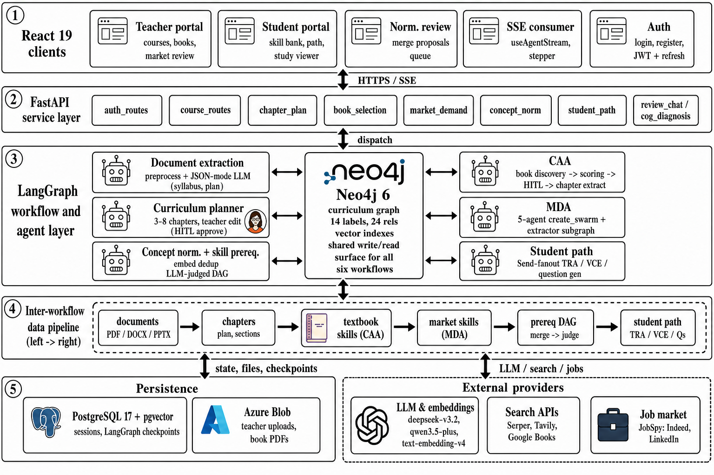

The implementation is organized around teacher and student clients, FastAPI modules, LangGraph workflows, SQL persistence, Neo4j graph storage, blob storage, and external LLM/search providers. The diagram shows the runtime structure behind the teacher-governed evidence workflow.

### 2. Neo4j graph schema

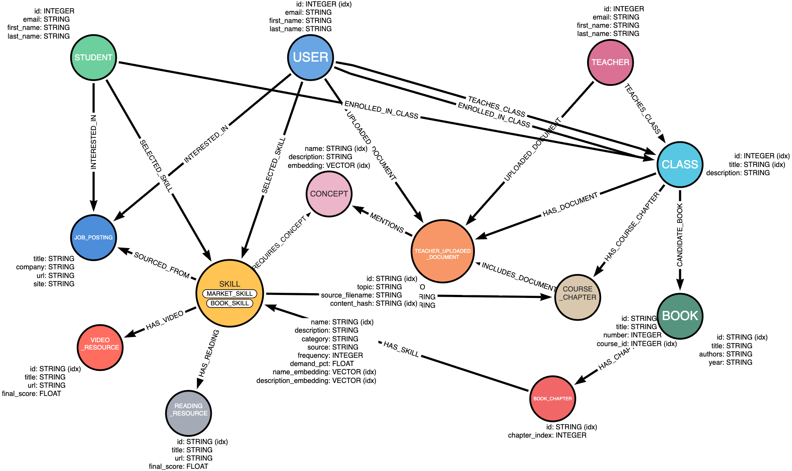

The graph schema keeps course chapters, documents, concepts, book skills, market skills, prerequisite relations, resources, questions, and student interactions connected through provenance-preserving relationships.

### 3. Teacher course graph pipeline

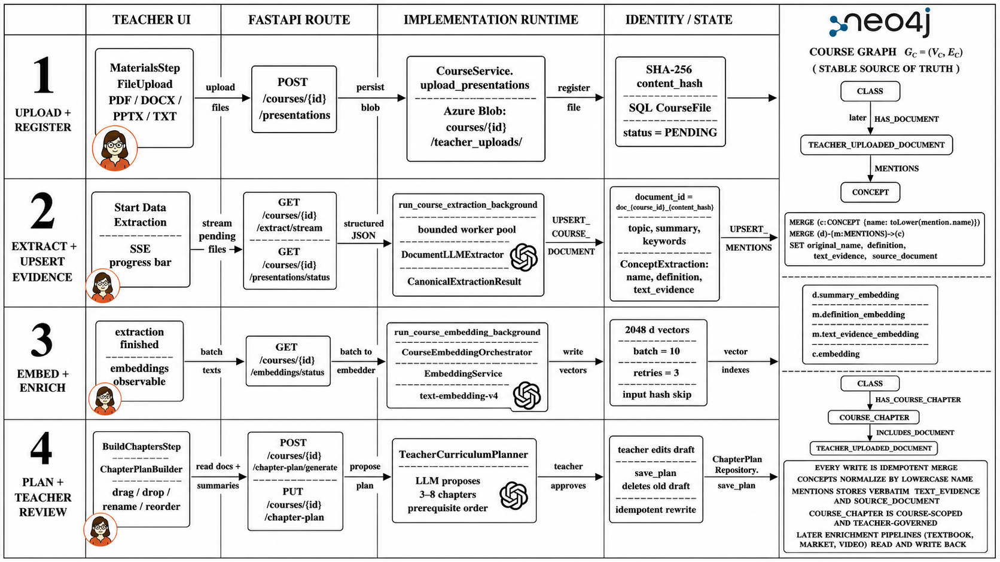

Teacher-provided course documents are uploaded, extracted, embedded, mapped into chapters and concepts, and written into the graph. This baseline graph anchors the textbook, market, prerequisite, and learning-resource layers.

### 4. Book discovery and scoring

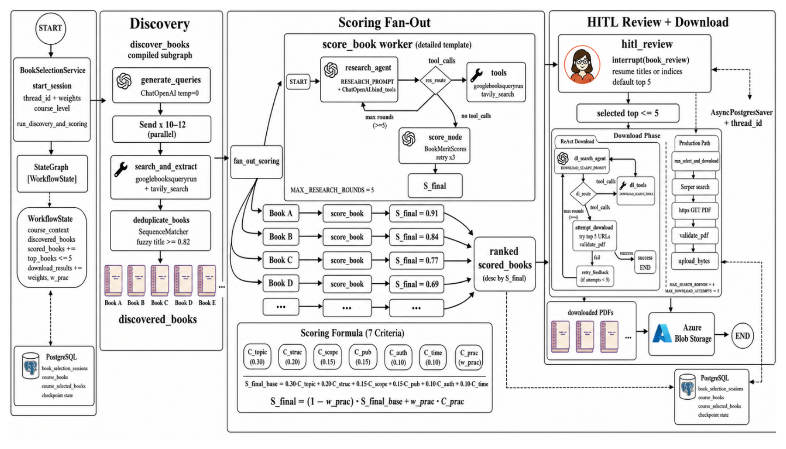

The book-selection workflow searches candidate textbooks, scores them with implementation criteria, and keeps teacher approval as the gate before later chapter-level skill extraction.

### 5. Book extraction and curriculum mapping

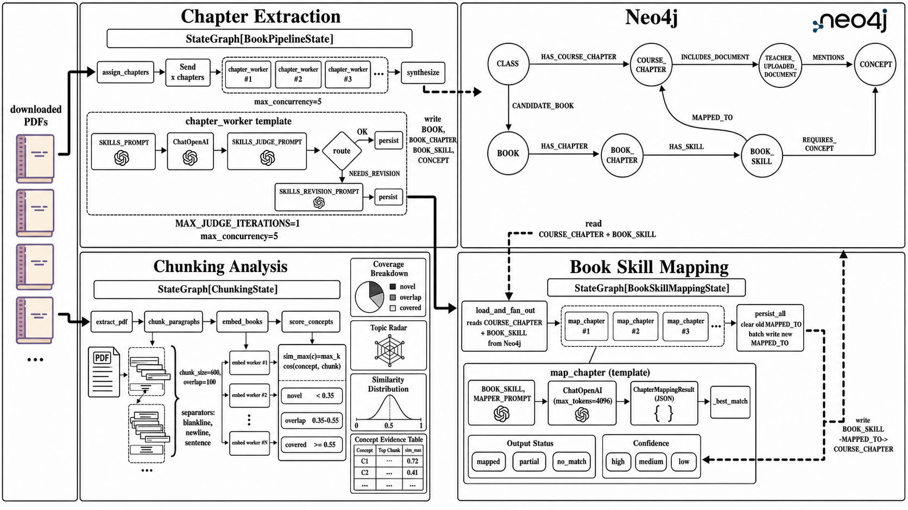

After teacher approval, textbook chapters are extracted, checked, mapped back to course chapters, and written as graph-connected book-skill evidence rather than as a replacement curriculum.

### 6. Market skill swarm

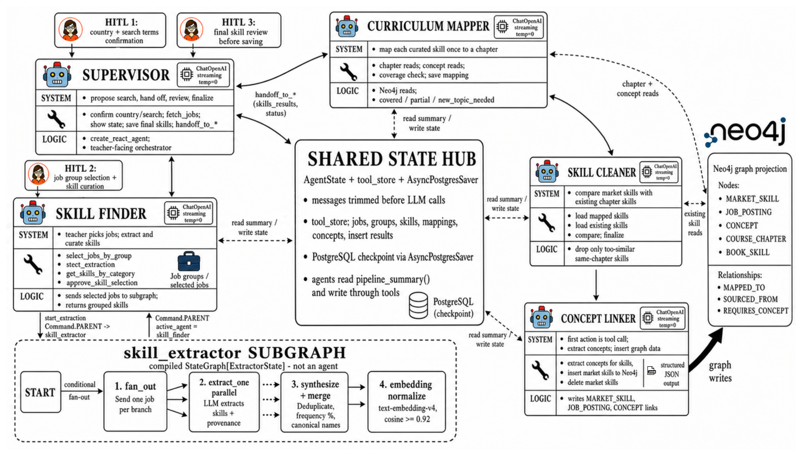

The Market Demand Analyst workflow uses role-scoped job evidence, skill extraction, grouping, curriculum mapping, and teacher review to produce market-skill graph artifacts.

### 7. Prerequisite graph

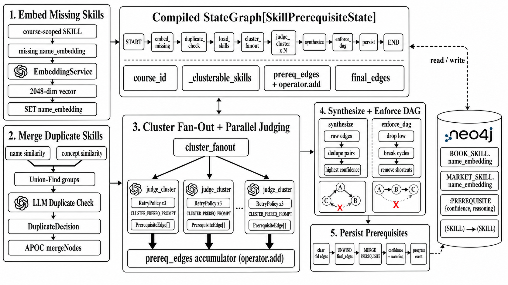

Book-derived and market-derived skills are organized into prerequisite relations. The implementation keeps these relations reviewable and course-connected, supporting sequencing and prerequisite-gap inspection.

### 8. Reading-resource retrieval

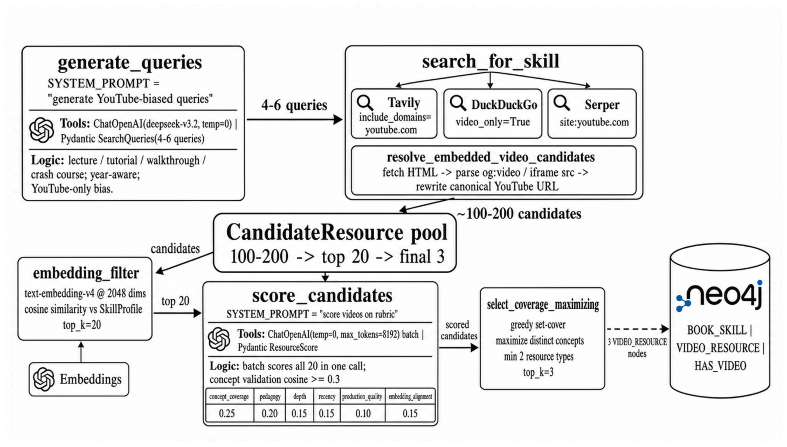

For selected skills, the reading branch retrieves and evaluates candidate readings using graph context, then writes linked resources back to the knowledge graph.

### 9. Video-resource retrieval

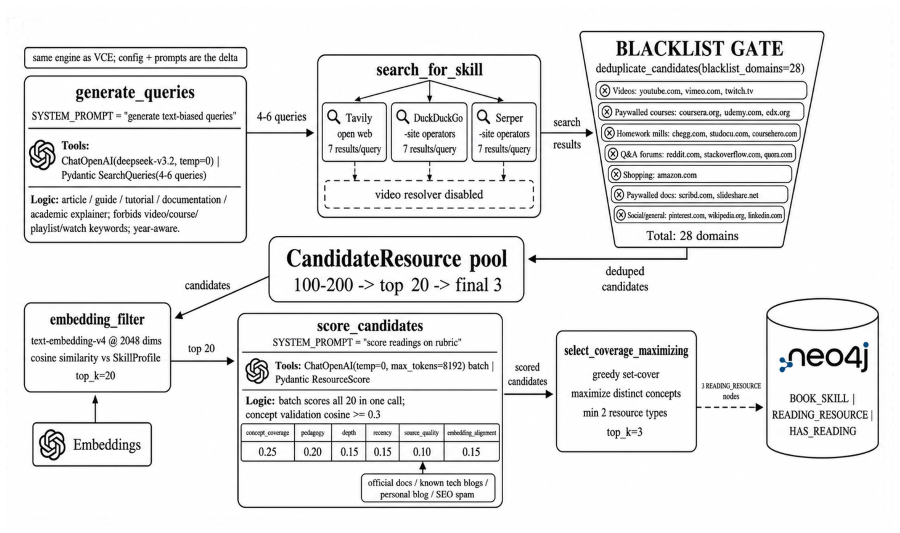

The video branch follows the same skill-conditioned pattern for video resources, preserving source evidence, suitability checks, and graph links.

### 10. Student learning-path resource support

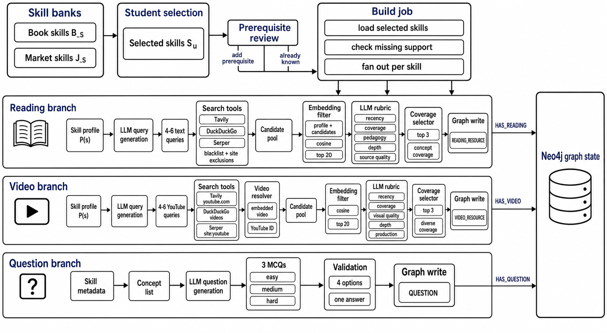

The student-facing assembly layer reads reviewed skills, prerequisite relations, readings, videos, and questions from the graph to build course-connected study paths.

### 11. Review interfaces

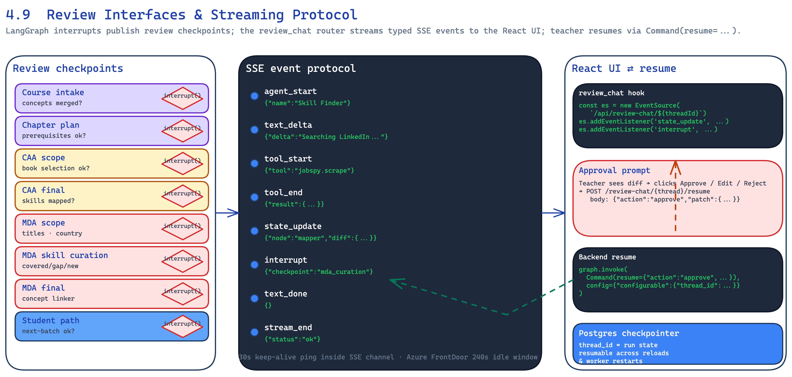

The implementation exposes teacher-facing review points for course evidence, textbook enrichment, market-skill decisions, and resource/pathway support so generated artifacts remain inspectable.

### 12. Deployment and CI/CD

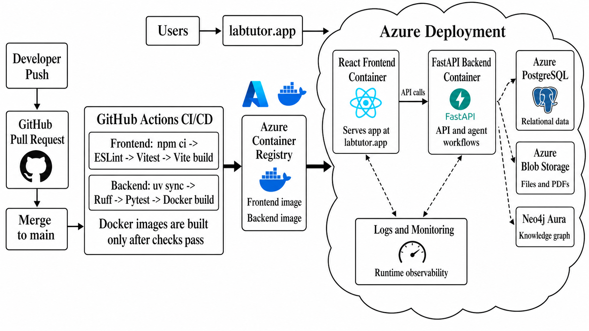

The deployment view shows how frontend, backend, persistence services, external providers, CI/CD checks, and deployment safeguards fit around the implementation.
