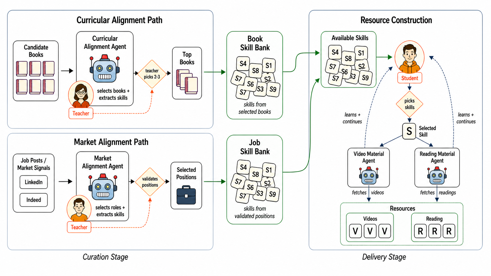
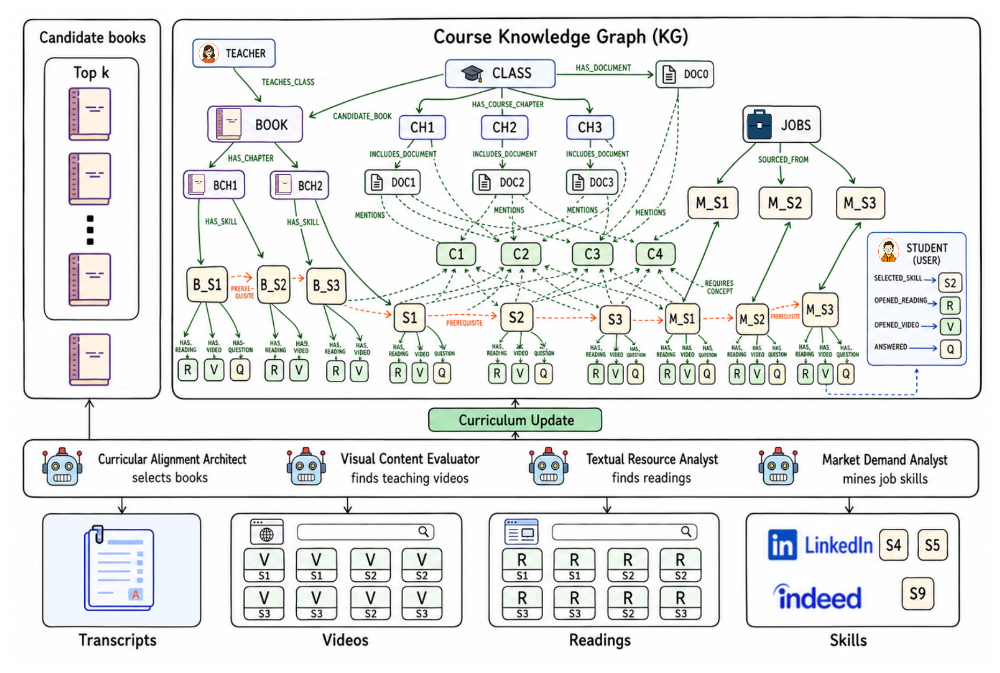
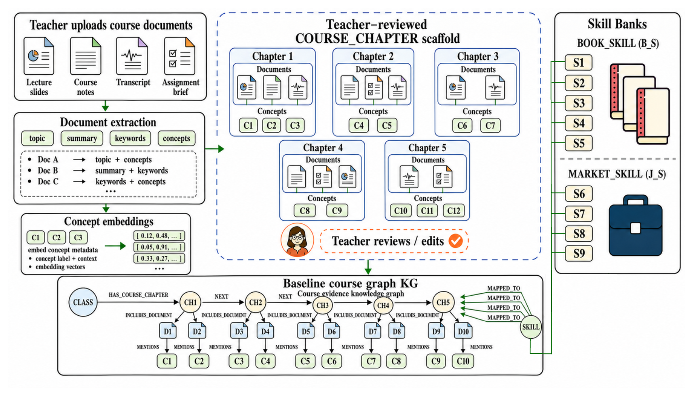
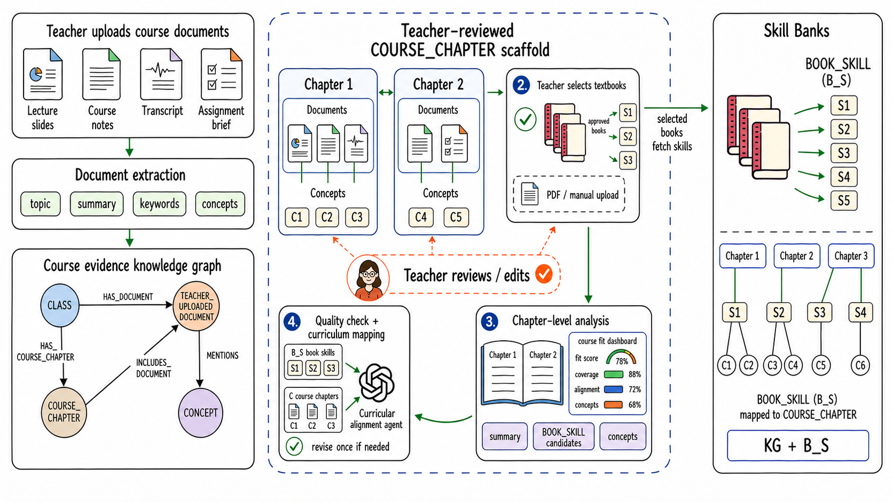
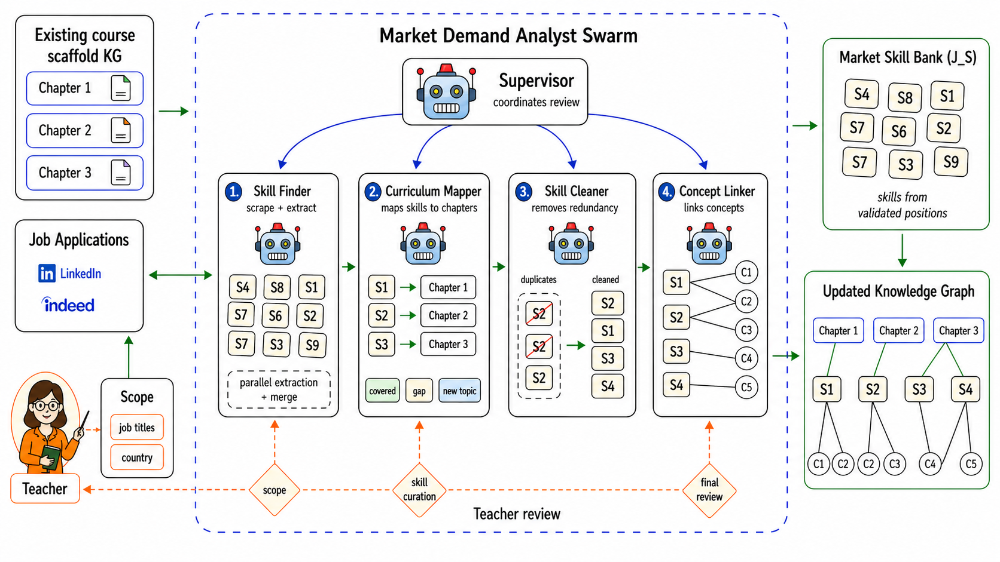
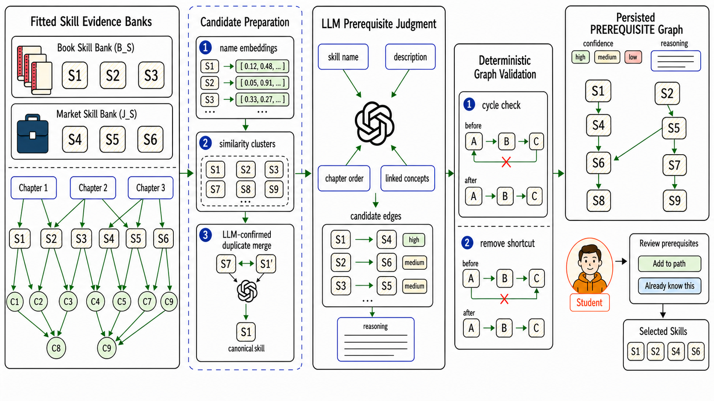
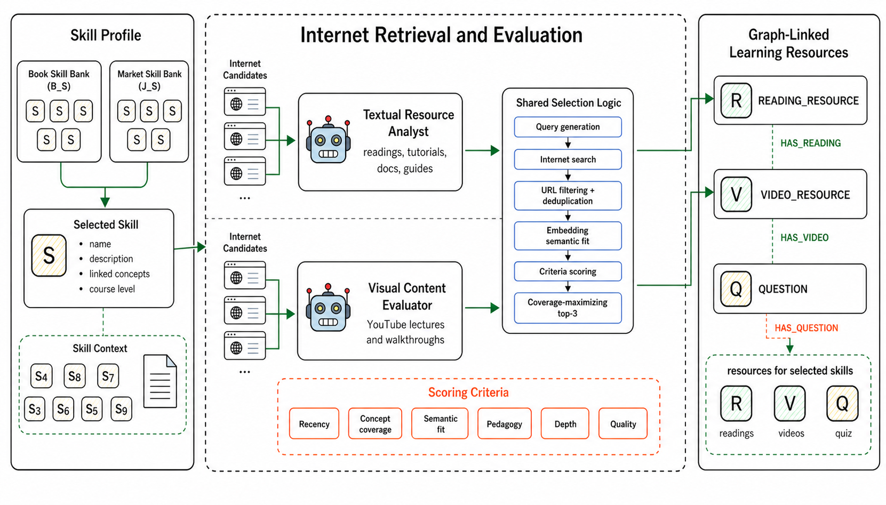
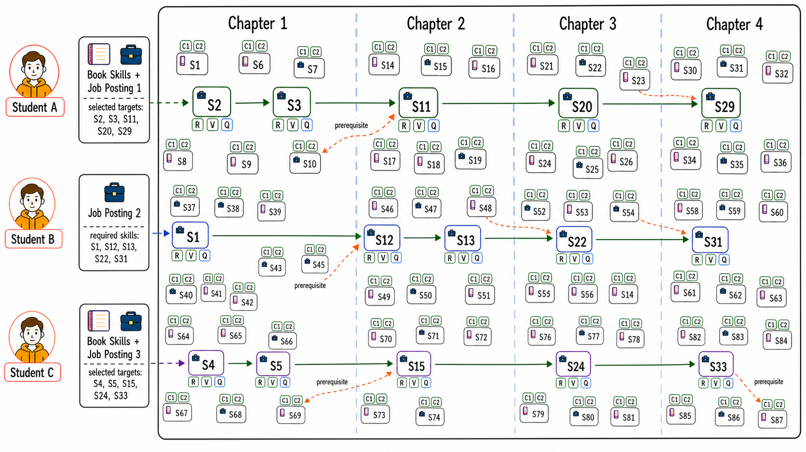

# Lab Tutor Methodology

Lab Tutor uses a teacher-governed evidence workflow to connect course materials, textbook-backed foundational skills, teacher-scoped job-market evidence, prerequisite relations, and learning resources. The methodology preserves provenance by keeping generated artifacts linked to course chapters, concepts, source documents, selected textbooks, job postings, and resource decisions.

The claim boundary is intentionally narrow: Lab Tutor supports inspectable curriculum-market evidence and course-connected learning-resource construction. It does not claim measured learning gains, employability improvements, employment outcomes, hiring causality, or autonomous curriculum redesign.

The diagrams below were copied from Chapter 3 of the submitted master's thesis figure assets. To update them, update and export the thesis figure source first, then recopy the exported PNGs into `docs/images/methodology/` using the same filenames.

## Diagram Sequence

### 1. Two-stage methodology

The workflow has two linked stages. First, teacher materials, reviewed textbooks, and teacher-scoped job postings produce a teacher-grounded course graph, a textbook skill bank, and a market skill bank. Second, selected skills are ordered with prerequisite relations and connected to readings, videos, and generated questions.

### 2. Knowledge graph and evidence structure

The graph structure keeps the course scaffold, evidence banks, prerequisite graph, and resource layer connected. Course chapters anchor the evidence so textbook skills, market skills, concepts, and resources can be inspected through their source links.

### 3. Teacher-grounded course graph

The baseline graph starts from teacher-owned course materials. Uploaded documents become source-linked concepts and reviewed course chapters, forming the stable course context used by later enrichment steps.

### 4. Textbook skill enrichment

Teacher-approved textbooks add stable disciplinary evidence. Extracted textbook skills are mapped back to the existing course chapters, producing a course-connected skill bank without replacing the teacher's curriculum.

### 5. Market skill-bank construction

Market evidence comes from teacher-scoped job postings. The system extracts, groups, and maps candidate skills, while teacher review controls which market-facing skills are retained as course evidence.

### 6. Prerequisite graph construction

Book-derived and market-derived skills are organized into reviewable prerequisite relations. This graph supports sequencing and prerequisite-gap inspection, but it remains a decision-support artifact rather than a validated mastery model.

### 7. Skill-conditioned resource retrieval

For a selected skill, graph context drives retrieval of readings and videos and conditions question generation. Resources stay linked to the skill, course chapter, supporting concepts, and source evidence that motivated them.

### 8. Personalized learning paths

Student-facing paths assemble selected skills, prerequisite context, readings, videos, and questions from the reviewed evidence space. Personalization reflects student choices and graph context, not an opaque prediction of what a student should learn.
